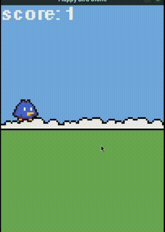

# Flappy Bird — Applying SOLID Principles 🐥💻

<p align="center" >
  <!-- Substitua o link do src pela sua imagem/gif de demonstração, se tiver -->
  
</p>

## Introduction
This repository contains the implementation of a **Flappy Bird** clone, developed using the **pygame** library. The project was carried out as part of a **Software Engineering** course assignment, aiming to apply **SOLID** principles to improve code quality.

## About the Assignment
The assignment was structured into five main stages:

1. **Theoretical Research on SOLID Principles**
   - Studying SOLID principles through books, articles, and videos.
   - Identifying practical examples and analyzing the importance of these principles in software design.
   - Producing a theoretical summary for the final report.

2. **Creation/Reutilization of an Initial Algorithm (Without SOLID)**
   - Developing a first version of the game **without applying SOLID**.
   - Identifying common problems such as monolithic code, excessive coupling, and low flexibility.

3. **Refactoring with SOLID**
   - Analyzing violations of principles in the initial code.
   - Refactoring to apply SOLID and improve code structure.

4. **Documentation and Comparison**
   - Preparing a detailed report describing the initial code flaws.
   - Explaining how each SOLID principle was applied during refactoring.
   - Comparing the versions before and after refactoring, highlighting improvements.

5. **Presentation and Demonstration**
   - Demonstrating the game before and after refactoring.
   - Explaining the corrected problems and the benefits of applying SOLID.

## Technologies Used 🔍
- **Python**
- **Pygame**

## Repository Structure
```
📂 flappy-bird-solid
 ├── 📂 src              # Source code
 ├── 📂 LaTeX            # LaTeX project presentation
```

## How to Run

Make sure [UV](https://docs.astral.sh/uv/) is installed, then run the following commands from the project root:

1. Install and synchronize the project dependencies:
   ```bash
   uv sync
   ```
2. Run the game:
   ```bash
   uv run ./src/main.py
   ```

### Progressive Development with SOLID

The project started as a nearly procedural Flappy Bird clone, without applying any SOLID principles. The principles were then introduced one by one in an incremental manner.

Each file represents a step in this transformation:

main_s.py applies the Single Responsibility Principle (S).

main_o.py incorporates Open/Closed Principle (O).

main_l.py introduces the Liskov Substitution Principle (L).

And so forth, gradually integrating each SOLID principle.

The development from one version to the next is constructive, ensuring each new iteration builds upon the previous improvements while maintaining functionality.
Aqui está uma explicação mais clara sobre a evolução do código ao aplicar o **Single Responsibility Principle** (SRP):

### **From `main.py` to `main_s.py` (Applying Single Responsibility Principle)**

```python
#imports...

class Game:
    def __init__(self):
        # initating pygame and all objects properties...

    def move_background(self, dt):
        # logic...
    
    def move_bird(self, dt):
        # logic...

    def animate_bird(self):
        # logic...
    
    # mover canos
    def move_pipes(self, dt):
        # logic...

    def handle_collision(self):
        # logic...
    
    # resetar o jogo
    def reset_game(self):
        # logic...

    def update(self, dt):
        # logic...

    # desenhar objetos
    def draw(self):
        # logic...

    # game loop
    def run(self):
        while self.running:
            dt = self.clock.tick() / 1000
            self.handle_events()
            self.update(dt)
            self.draw()

        # Quit services
        pygame.quit()

if __name__ == "__main__":
    game = Game()
    game.run()
```

Initially, the project started with a **monolithic** `Game` class, where all functionalities were tightly coupled within a single class. This version had several responsibilities mixed together, including:
- Handling game logic.
- Managing background movement.
- Updating and animating the bird.
- Handling collisions.
- Drawing objects on the screen.

This violated the **Single Responsibility Principle (SRP)** because a single class was responsible for too many tasks.

#### **Refactoring for SRP**

```python
#imports...

class Object():
    # generic object...

class ObjectContainer():
    # logic...

class Background(Object):
    # logic...

class Bird(Object):
    # logic...

class DoublePipe(Object):
    # logic...

class Death(Object):
    # logic...

class Score(Object):
    # logic

class Game:
    def __init__(self):
        # init pygame...

        # instantiate objects...
        self.bird = Bird()
        self.background = Background()
        self.double_pipe = DoublePipe()
        self.death = Death(self.bird, self.double_pipe, self.reset)
        self.score = Score()
        self.score_observer = ScoreObserver(self.bird, self.double_pipe, self.score)

        self.objects_container = ObjectContainer([
            self.bird,
            self.background,
            self.double_pipe,
            self.death,
            self.score,
            self.score_observer
        ])

    def reset(self):
        # logic...
    
    # resolver os eventos
    def handle_events(self):
        # logic...

    # atualizar jogo
    def update(self, dt):
        # logic..

    # desenhar objetos
    def draw(self):
        # logic...
    
    # game loop
    def run(self):
        while self.running:
            dt = self.clock.tick() / 1000
            self.handle_events()
            self.update(dt)
            self.draw()

        # Quit services
        pygame.quit()

if __name__ == "__main__":
    game = Game()
    game.run()
```

To address this issue, the responsibilities were **separated into distinct classes**, each handling a specific aspect of the game. The refactored version (`main_s.py`) introduces:
- **`Background` class**: Handles the background movement.
- **`Bird` class**: Manages the bird's movement and animations.
- **`DoublePipe` class**: Controls the pipe obstacles.
- **`Death` class**: Detects collisions and resets the game.
- **`Score` class**: Tracks the player's score.
- **`ObjectContainer` class**: Maintains a collection of game objects.

Now, the `Game` class focuses only on:
- Initializing objects.
- Managing the game loop.
- Handling high-level game state transitions.

This refactoring **reduces coupling**, **improves maintainability**, and **makes future modifications easier**. The next step (`main_o.py`) builds upon this foundation by applying the **Open/Closed Principle (OCP)**.

### **From `main_s.py` to `main_o.py` (Applying Open/Closed Principle)**


After implementing the **Single Responsibility Principle (SRP)**, the next step was applying the **Open/Closed Principle (OCP)**. In `main_s.py`, all objects had fixed behaviors, meaning any change in movement logic required modifying existing classes, which violates OCP.

#### **Refactoring for OCP**

```python
#imports...

class Object():
    # generic object...

class MovableObject(Object):
    # movable generic object..

class HorizontalMovableObject(MovableObject):
    # generic horizontal movable object...

class ObjectContainer():
    # logic...

class Background(MovableObject):
    # logic...

class Bird(MovableObject): # add HozizontalMovable to move bird
    # logic...

class DoublePipe(Object):
    # logic...

class Death(Object):
    # logic...

class Score(Object):
    # logic

class Game:
    def __init__(self):
        # init pygame...

        # instantiate objects...
        self.bird = Bird()
        self.background = Background()
        self.double_pipe = DoublePipe()
        self.death = Death(self.bird, self.double_pipe, self.reset)
        self.score = Score()
        self.score_observer = ScoreObserver(self.bird, self.double_pipe, self.score)

        self.objects_container = ObjectContainer([
            self.bird,
            self.background,
            self.double_pipe,
            self.death,
            self.score,
            self.score_observer
        ])

    def reset(self):
        # logic...
    
    # resolver os eventos
    def handle_events(self):
        # logic...

    # atualizar jogo
    def update(self, dt):
        # logic..

    # desenhar objetos
    def draw(self):
        # logic...
    
    # game loop
    def run(self):
        while self.running:
            dt = self.clock.tick() / 1000
            self.handle_events()
            self.update(dt)
            self.draw()

        # Quit services
        pygame.quit()

if __name__ == "__main__":
    game = Game()
    game.run()
```

To allow **extensibility without modifying existing code**, a new **hierarchy of movement-related classes** was introduced:
- **`MovableObject`**: A generic class for all objects that can move.
- **`HorizontalMovableObject`**: A specialization of `MovableObject` that provides horizontal movement logic.

### **Key Changes**
1. The `Background` and `Bird` classes now extend `MovableObject`, allowing them to be moved without modifying their core logic.
2. `HorizontalMovableObject` is introduced as a reusable specialization for horizontal movement controlled by keyboard input. In the current snapshot, however, neither `Bird` nor `Background` inherits from this class.
3. The overall structure of `Game` remains the same, while shared movement behavior is moved into a base class. This is a step toward the **Open/Closed Principle (OCP)** because common movement behavior can be extended through inheritance instead of being duplicated in every object.

This approach can **reduce code duplication** and **make movement behavior easier to reuse**. The next section discusses the **Liskov Substitution Principle (LSP)** and clarifies what the current `main_l.py` version demonstrates.


### **From `main_o.py` to `main_l.py` (Liskov Substitution Principle)**

The **Liskov Substitution Principle (LSP)** states that an instance of a subtype should be usable wherever an instance of its base type is expected, without breaking the program's expected behavior.

In this project, the `ObjectContainer` works with different game entities through common operations:

```python
for object in self.objects:
    object.update(dt)
```

It also draws objects through a shared `draw(display_surface)` operation. This design relies on objects respecting the behavior expected by the container. For example, an object added to the drawable collection must provide the attributes and methods required for rendering, while every managed object must support updates.

### **From `main_l.py` to `main_i.py` (Interface Segregation Principle)**

The **Interface Segregation Principle (ISP)** states that a class should not be forced to depend on operations it does not need. In this game, not every object needs to be rendered on the screen.

Before this step, `Death` and `ScoreObserver` inherited from `Object`, even though they only performed logic and did not have anything to draw. They passed `None` for visual attributes and still belonged to the same hierarchy as visible game elements.

#### **Refactoring for ISP**

`main_i.py` introduces `InvisibleObject`, which represents game entities that need to be updated but do not need to be drawn:

```python
class InvisibleObject:
    def update(self, dt):
        pass

class Death(InvisibleObject):
    # Checks collisions and triggers the game reset.
    ...

class ScoreObserver(InvisibleObject):
    # Detects when the player passes a pipe and updates the score.
    ...
```

`Death` and `ScoreObserver` now inherit from `InvisibleObject` rather than `Object`. The rendering loop also filters out objects that are not part of the visual-object hierarchy:

```python
objects = filter(
    lambda x: type(x).__base__ in [Object, MovableObject],
    self.objects
)
for object in sorted(objects, key=lambda x: x.layer):
    object.draw(display_surface)
```

#### **Key Changes**

- **`InvisibleObject`** separates update-only entities from objects that are rendered.
- **`Death`** contains collision and out-of-bounds checks without requiring image, rectangle, or layer attributes.
- **`ScoreObserver`** monitors pipe passage and updates the score without being treated as a visual element.
- **`ObjectContainer`** avoids attempting to draw these invisible entities.

This is a practical application of ISP because logic-only objects no longer need to carry visual-object data just to participate in the update loop.

### **Dependency Inversion Principle (DIP)**

The **Dependency Inversion Principle** has two parts:

1. High-level modules should not depend directly on low-level modules; both should depend on abstractions.
2. Abstractions should not depend on implementation details; implementation details should depend on abstractions.

Applied to a game, this can mean designing high-level game logic around abstractions for the services it needs, rather than hard-coding every concrete implementation. For example, a game system could receive an input provider or asset loader through its constructor instead of creating and depending directly on a specific implementation.

#### **Status of the current implementation**

The accompanying LaTeX presentation (`main.tex`) includes the theory and visual examples for DIP. However, among the supplied Python files, there is **no separate `main_d.py` or clear DIP-specific refactoring**. For that reason, this README does not describe DIP as an implemented code stage. A future version could demonstrate it by introducing a small abstraction and injecting its implementation into the game logic.

### **Conclusion**

This project uses a Flappy Bird clone to explore how SOLID principles can guide object-oriented design. The progression from a monolithic `Game` class toward separate game entities illustrates how responsibilities can be distributed and how common behavior can be reused.
